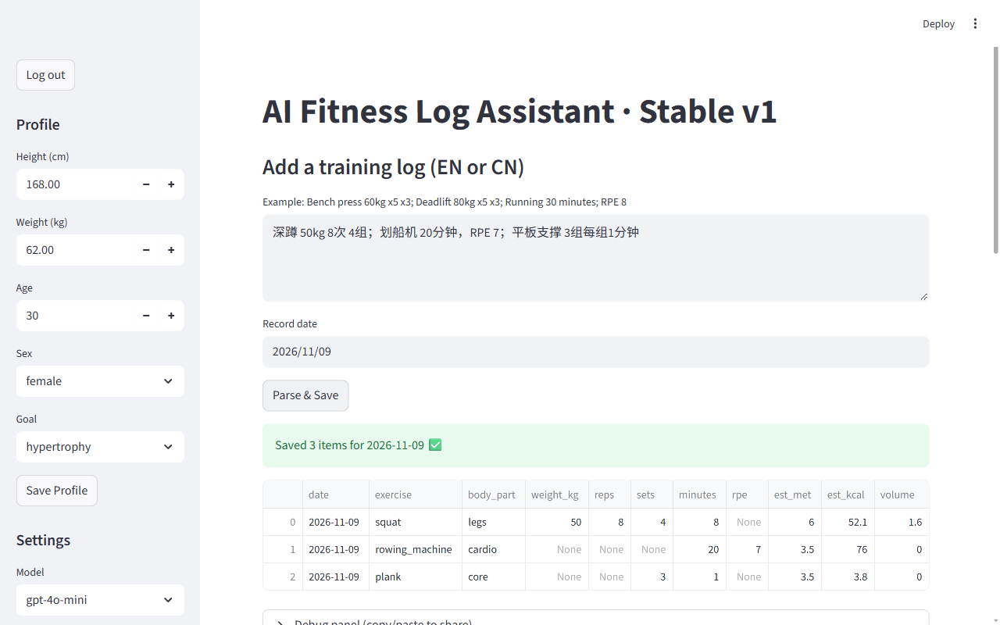

# AI Fitness Log Assistant

[简体中文](README.zh-CN.md)

Type your workout the way you would text a friend, in English or Chinese. An LLM turns it into structured records; the app then estimates calories, tracks how recently each body part was trained, and suggests what to do next.

A small personal demo I built in a couple of days in August 2025. The code is published as it was written then: one Streamlit file, CSV storage, no database.

<p align="center">
  
</p>

## What it does

1. **Parse.** Free-form notes such as `Bench press 60kg x5 x3; Running 30 minutes; RPE 8` go to the OpenAI API with a strict prompt. The model returns JSON items: date, exercise, body part, weight, reps, sets, minutes, RPE.
2. **Enrich.** Each item gets estimated minutes, a MET value, calories (`MET × 3.5 × body weight kg × minutes / 200`) and a training volume.
3. **Track.** Every body part has a "training heat" that decays with a 7-day half-life and grows with new volume. Below 1.0 it is flagged *needs more*, above 3.0 *needs rest*.
4. **Chart.** A 7-day calorie trend and the current heat per body part, with the two thresholds drawn in.
5. **Suggest.** One click sends the profile, the last 7 days and the heat summary to the model for a few concrete tips and a short plan for today.

## Making the LLM output dependable

The part I cared most about was getting usable structured data out of messy input:

- JSON mode (`response_format={"type": "json_object"}`) at temperature 0;
- if the reply still isn't clean JSON, a regex pulls out the first JSON block;
- configurable retries and timeout; before a retry, Chinese punctuation (`；` `，` `×`) in the input is converted to ASCII;
- a debug panel shows the prompt, raw response, parsed JSON, any exception and the round-trip time, so a bad parse can be diagnosed from the UI.

## Run it

Requires Python 3.13 and an OpenAI API key.

```sh
pipenv install            # or: pip install streamlit pandas altair python-dateutil openai
export OPENAI_API_KEY="sk-..."
export FITNESS_APP_PASSWORD="choose-a-password"   # the app has a simple password gate
streamlit run app.py
```

On Windows PowerShell use `$env:OPENAI_API_KEY = "sk-..."` and `$env:FITNESS_APP_PASSWORD = "..."`.

Re-checked in November 2026 with the locked dependency versions: logging in, parsing a Chinese log with `gpt-4o-mini` and generating suggestions all worked.

## Files

| Path | What's in it |
|---|---|
| `app.py` | The whole app |
| `data/users.csv` | One profile (made-up values) |
| `data/workouts.csv`, `data/heat.csv` | A few days of sample records; the app appends to them |
| `Pipfile`, `Pipfile.lock` | Dependencies |

UI text is in English; code comments are in Chinese.

## Limitations

- Single user, CSV files, and a plain password check against an environment variable. Fine for a local demo, not for real use.
- MET values come from a short built-in list. A cardio exercise not on it (for example "rowing machine" instead of "rowing") falls back to a strength-training MET, so its calories are underestimated.
- Calories and "heat" are rough proxies, not medical or training advice.
- The sample records are from 2025, so the 7-day views start empty until you add new logs.

## License

[MIT](LICENSE)
