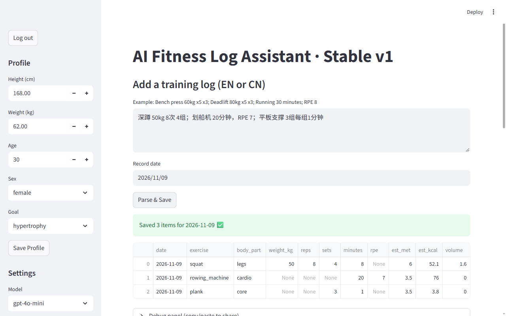

# AI 健身日志助手

[English](README.md)

像发微信一样随手写下今天练了什么，中文英文都行。大模型把它整理成结构化记录，应用再估算卡路里、记下每个部位多久没练了，并建议下一步练什么。

这是我 2025 年 8 月花两三天做的个人小 demo。代码按当时写的原样放出：一个 Streamlit 文件，数据存 CSV，没有数据库。

<p align="center">
  
</p>

## 它做什么

1. **解析。** 像 `深蹲 50kg 8次 4组；跑步 30分钟 RPE 8` 这样的随手记录，用严格的提示词发给 OpenAI，模型返回 JSON：日期、动作、部位、重量、次数、组数、分钟、RPE（主观用力程度）。
2. **补全。** 每条记录估算时长、MET（运动强度系数）、卡路里（`MET × 3.5 × 体重公斤 × 分钟 / 200`）和训练量。
3. **追踪。** 每个部位有一个「训练热度」，按 7 天半衰期衰减，练了就往上加。低于 1.0 提示「该练了」，高于 3.0 提示「该歇了」。
4. **画图。** 7 天卡路里趋势，和各部位当前热度（画出两条阈值线）。
5. **建议。** 点一下，把个人资料、最近 7 天和热度摘要发给模型，返回几条具体建议和今天的小计划。

## 让大模型的输出靠得住

我最在意的是从乱七八糟的输入里稳定拿到能用的结构化数据：

- 强制 JSON 模式（`response_format={"type": "json_object"}`），温度 0；
- 返回的还不是干净 JSON，就用正则抠出第一段 JSON；
- 重试次数和超时可调；重试前先把输入里的中文标点（`；` `，` `×`）换成英文的；
- 调试面板显示提示词、原始返回、解析结果、异常和往返耗时，解析出错能直接在界面上查。

## 运行

需要 Python 3.13 和 OpenAI API key。

```sh
pipenv install            # 或：pip install streamlit pandas altair python-dateutil openai
export OPENAI_API_KEY="sk-..."
export FITNESS_APP_PASSWORD="自己定一个密码"   # 应用有个简单的密码门
streamlit run app.py
```

Windows PowerShell 里用 `$env:OPENAI_API_KEY = "sk-..."` 和 `$env:FITNESS_APP_PASSWORD = "..."`。

2026 年 11 月按锁定的依赖版本重新跑过：登录、用 `gpt-4o-mini` 解析中文记录、生成建议都正常。

## 文件

| 路径 | 内容 |
|---|---|
| `app.py` | 整个应用 |
| `data/users.csv` | 一份个人资料（虚构数值） |
| `data/workouts.csv`、`data/heat.csv` | 几天的示例记录，应用会往里追加 |
| `Pipfile`、`Pipfile.lock` | 依赖 |

界面是英文，代码注释是中文。

## 局限

- 单用户、CSV 文件，密码只是和环境变量直接比对。本地演示够用，不适合真用。
- MET 来自一张很短的内置表。表里没有的有氧动作（比如写成「划船机」而不是「rowing」）会退回力量训练的 MET，卡路里会估低。
- 卡路里和「热度」都是粗略估算，不是医疗或训练建议。
- 示例记录是 2025 年的，所以 7 天视图一开始是空的，加了新记录才会有。

## 许可证

[MIT](LICENSE)

---

如果觉得这个项目有用或有意思，欢迎点个 ⭐，让更多人看到它。谢谢！
